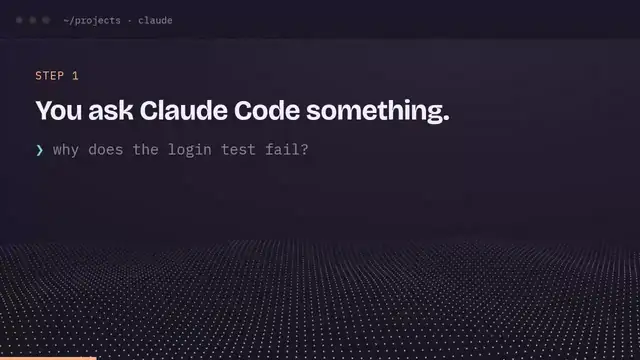

<p align="center">
  
</p>

<h1 align="center">TL;DR Voice</h1>

<p align="center">
  A Claude Code plugin: every answer opens with a one-line <code>TL;DR:</code>,<br>
  and a voice reads it aloud while the rest is still printing. English or German.
</p>

<p align="center">
  
  
  
  
  <a href="LICENSE"></a>
</p>

<p align="center">
  
</p>

<p align="center">
  🔊 <a href="docs/ava-sample.mp3"><b>Hear a sample</b></a> (Ava voice):<br>
  <i>"I fixed the failing login test, and all checks pass now. Should I open a pull request?"</i>
</p>

---

## Install

In Claude Code:

```bash
/plugin install tldr-voice --marketplace d-shiri/tldr-voice
```

Pick **English** or **German** when asked, then restart Claude Code. On first start the plugin sets up its voices in the background, which takes about a minute. After that, every answer is read aloud.

> [!IMPORTANT]
> Needs **Python 3** and [`mpv`](https://mpv.io) on **Linux**, **macOS** or **Windows**. [`uv`](https://docs.astral.sh/uv/) makes setup faster.
>
> ```bash
> sudo apt install mpv     # Linux (Debian, Ubuntu)
> brew install mpv uv      # macOS, with Homebrew
> winget install Git.Git Python.Python.3.12 shinchiro.mpv astral-sh.uv   # Windows
> ```
>
> On macOS, `python3` comes with the Xcode command line tools (`xcode-select --install`). On Windows, the hooks run in Git Bash, so Git for Windows is required; restart Claude Code after installing. Under WSL it runs like Linux.

**Claude Code older than 2.1.275?** Install in two steps:

```bash
# 1. Add the marketplace
/plugin marketplace add d-shiri/tldr-voice

# 2. Install the plugin
/plugin install tldr-voice@tldr-voice
```

**Let Claude do it:** paste this prompt into Claude Code:

```markdown
Install the tldr-voice plugin for me: run `claude plugin marketplace add d-shiri/tldr-voice`
and `claude plugin install tldr-voice@tldr-voice`, make sure python3 and mpv are installed
(install mpv if missing: apt on Linux, Homebrew on macOS, winget on Windows, where Git for
Windows is needed too), then tell me to restart Claude Code.
```

## Use

Click the 🔊 icon above the prompt to mute or unmute, and 🗘 beside it to hear the session's last TL;DR again, or use the command. (From your third day of use, the same row asks once for a GitHub star; ⭐ opens the repository, ✕ hides it for good.)

| Command | What it does |
| --- | --- |
| `/tldr-voice:voice off` · `on` | Mute or unmute |
| `/tldr-voice:voice language de` · `en` | Speak German or English |
| `/tldr-voice:voice engine piper` | Offline voice only (`edge` = online, the default) |
| `/tldr-voice:voice name on` · `off` | Say which project a reply comes from ("Message from tldr voice.") when you aren't looking at it |
| `/tldr-voice:voice speed 1.2` | Speak faster or slower, from `0.5` to `2` (`1` is normal) |
| `/tldr-voice:voice stop` | Stop talking now |
| `/tldr-voice:voice again` | Say the last TL;DR again (the 🗘 next to 🔊 does it for that session) |
| `/tldr-voice:voice test` | Hear the voice |
| `/tldr-voice:voice status` | Show the current settings |

In the terminal the TL;DR line is drawn with a 📣 on its left and in Claude's orange, so it is easy to spot. The reply itself keeps the plain `TL;DR:` line.

With `name on`, the project's name is its tmux window's name, or the project folder's name outside tmux. It is said when that window isn't the one on your screen, and left out when it is. Outside tmux, where that can't be told, it is said when the voice comes from another project than last time. It is recorded once per name, so it plays at once, while the reply's line is still on its way.

With several sessions running, every reply gets heard: when one finishes while another is speaking, its line waits its turn. A newer line from the session that is speaking replaces what it was saying.

> [!TIP]
> Sending your next message stops that session's voice (another session's line plays on), and holding space to talk stops all of it. The hold-space stop needs `pactl` (PulseAudio or PipeWire), so it works on Linux only.

### Settings

Set these in the `env` block of `~/.claude/settings.json`:

```json
{
  "env": {
    "TLDR_VOICE_MIC_STOP": "0",
    "TLDR_VOICE_EDGE_VOICE": "en-US-AriaNeural"
  }
}
```

| Variable | Default | What it does |
| --- | --- | --- |
| `TLDR_VOICE_MIC_STOP` | `1` | `0` turns off the hold-space stop |
| `TLDR_VOICE_EDGE_VOICE` | `en-US-AvaNeural`, for German `de-DE-SeraphinaMultilingualNeural` | Picks another online voice, used for both languages |
| `TLDR_VOICE_EDGE_TIMEOUT` | `3` | Seconds to wait for the online voice before the offline voice speaks instead |

> [!TIP]
> The default voices start speaking in under a second. The English Multilingual voices (`en-US-AvaMultilingualNeural`, `en-US-EmmaMultilingualNeural`) sound a little richer but take 3 to 6 seconds on every new sentence; if you pick one, raise `TLDR_VOICE_EDGE_TIMEOUT` to `8`.

> [!NOTE]
> **Privacy:** the online voice sends only the TL;DR line (and, with `name on`, the project's name) to Microsoft's speech service. To start speaking sooner it opens its connection to that service when you send a prompt, before there is a line to send. `/tldr-voice:voice engine piper` keeps everything offline.

## Uninstall

```bash
/plugin uninstall tldr-voice@tldr-voice
```

Installed tldr-voice with the old `install.sh`? Run this from a clone of this repo first:

```bash
./remove-script-install.sh --purge
```

## License

[MIT](LICENSE). Uses [edge-tts](https://github.com/rany2/edge-tts), [Piper](https://github.com/OHF-Voice/piper1-gpl) and [mpv](https://mpv.io), downloaded on first use. Not affiliated with Anthropic or Microsoft.
